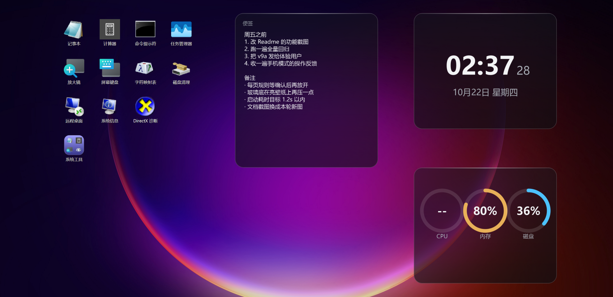
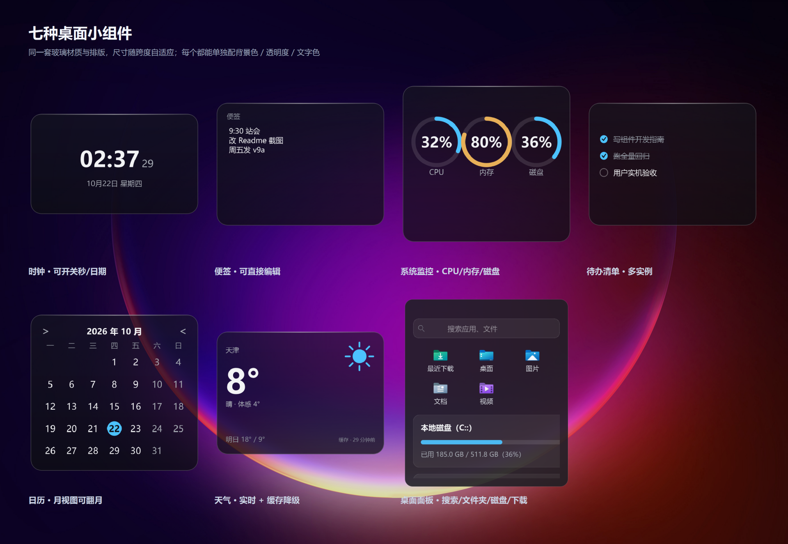
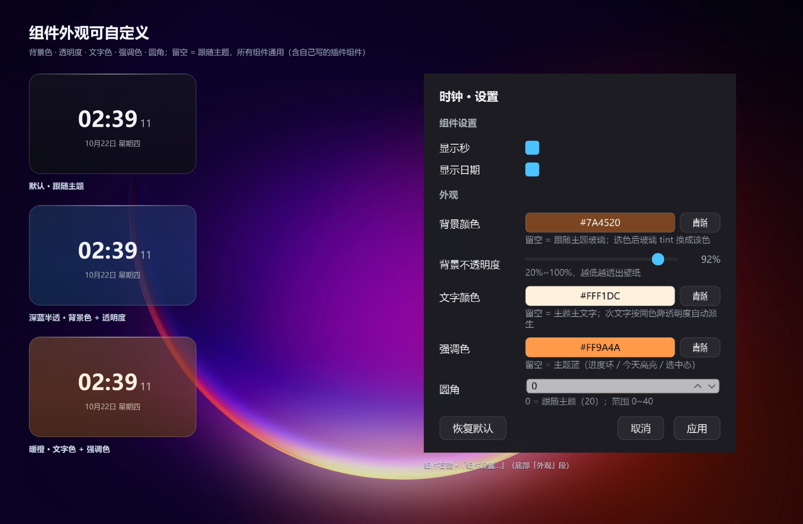
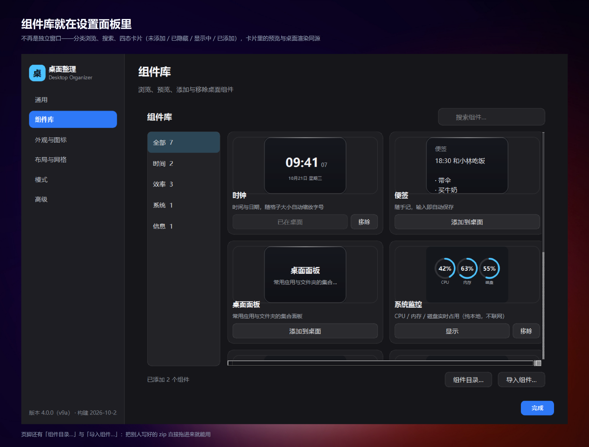
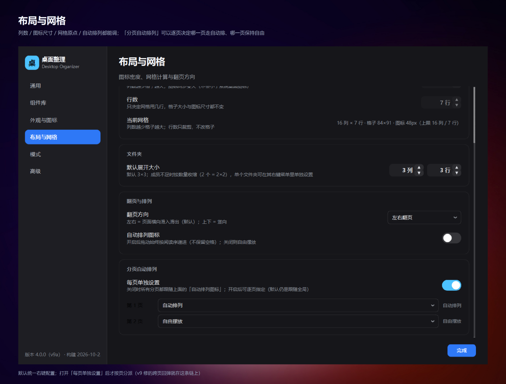
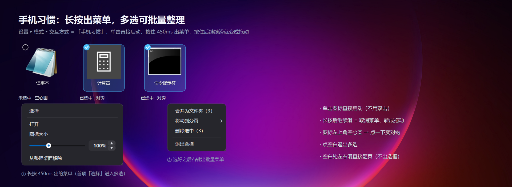
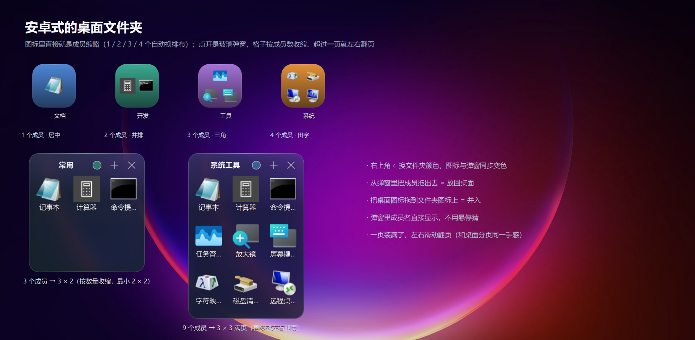
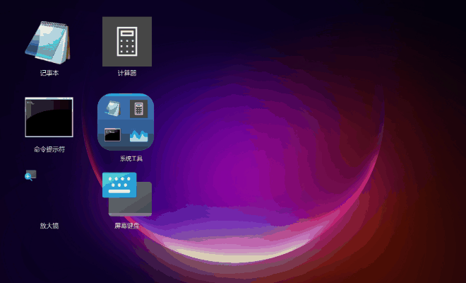
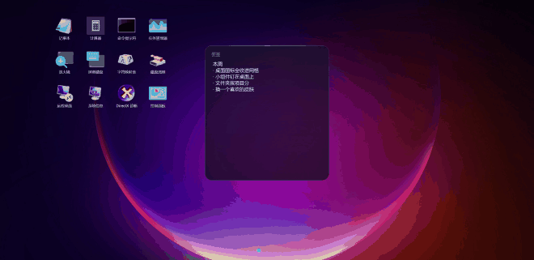

# DesktopOrganizer

*A free, open-source Windows desktop organizer — Android-style icon grid, spring-physics animations and native-feeling desktop widgets that turn your Windows desktop into a phone home screen.*

English | [简体中文](README.md)

> 🚧 **Under active development**: current version **v9a** (installer 4.0.0, first package of the v9 line) with **79 test files / ~1900 assertions green**; all 39 v7 field reports and the whole v8 widget center are closed. v9's first batch adds **per-widget appearance settings** (background / opacity / text / accent colour), a **widget plugin platform** (drop in a folder or a zip — see [docs/组件开发指南.md](docs/组件开发指南.md)), the **widget library merged into the settings panel**, **per-page auto-arrange rules**, and a **phone-style input mode** (single tap launches / long-press menu / multi-select with batch actions / swipe to flip pages). Bug reports and ideas are welcome via Issues — current spec: [docs/指导文档_v9.md](docs/指导文档_v9.md), plan: [docs/实施计划_v9.md](docs/实施计划_v9.md) (both Chinese).

[](https://github.com/a435630144/PhoneDesktopForWindow/releases)      [](LICENSE)

---

A third-party desktop organizer / beautifier for Windows in the spirit of Tencent Desktop Manager, with a **phone-style UI and interaction model**: it mounts its own grid layer above the native desktop and replaces native icons with a fully controlled rendering layer — positions, animations, folders and widgets are all yours to define.

Despite the name, this is **far past the prototype stage**: installer, tray residency, crash logging, single-instance guard, auto re-attach watchdog, **79 test files / ~1900 assertions**, plus a full dev log and handover guide ([DEVLOG.md](DEVLOG.md) / [HANDOVER.md](HANDOVER.md), both Chinese). `DesktopOrganizerDemo` is a legacy package name (install dir, single-instance key and registry entries hang off it) — renaming costs more than it buys.

<p align="center"></p>

---

## ✨ Features

| Module | Description |
|---|---|
| 🧭 Icon grid | Android-style grid layout with column count / icon size / DPI awareness; click to select, double-click to open, drag to move |
| 🤏 Slide-to-rearrange | Neighboring icons elastically slide aside while you drag (true spring physics curve), snap precisely to the target cell, and slide back on cancel |
| 📂 Drag-to-merge | Drag an icon onto another to merge into a folder; folder popup uses liquid-glass material with an emergence open/close animation; members can be dragged out / removed |
| 🖱️ Batch operations | Rubber-band multi-select + whole-group dragging |
| 🧩 Desktop widgets | Clock / Sticky notes (editable) / Desktop panel (search · quick folders · disks · recent downloads · weather) / **System monitor** (CPU · memory · disk) / **To-do list** (multi-instance) / **Calendar** (month view with remembered month) / **Weather** (live with cache fallback); supports **anchored (non-floating)** mode where widgets join the grid as first-class citizens, with drag-resize and icon mutual displacement |
| 🧩 Widget library | A page inside the settings panel: browse widgets by category, search, and see four-state cards (not added / hidden / on desktop / added) with **live previews rendered by the very same `draw()`** used on the desktop; import or uninstall third-party widget zips, and appearance edits apply immediately |
| 🔀 Two modes | **Organizer mode** (native icons hidden, desktop rendering taken over) / **native mode** (free-floating): one-click switch, and each mode **keeps its own layout** independently |
| 📑 Paging | Automatic paging when icons overflow; page dots + wheel paging, drag to the screen edge to flip |
| 🔄 Desktop sync | Watches the desktop folder (1 s debounce): new files enter automatically, deleted items are cleaned up |
| 🪄 Full takeover | Hides native icons and re-renders from the desktop folder clone, giving complete control over position and style (Route A); can also switch back to effects-only mode |
| 🖥️ Custom desktop context menu | No more losing right-click in organizer mode: new folder/text file, rescan, icon size, display/personalization settings |
| 🛡️ BandGuard daemon | Survives Win+D (show desktop) and explorer restarts — automatically re-mounts |
| ⏱️ System tray | Pause auto-creation / restore native, rescan, panel toggle, autostart, settings |

## 📸 Screenshots

> Every image below is rendered off-screen from the **real widgets** by [`tools/shot_readme.py`](tools/shot_readme.py) — the grid, the glass widgets and the context menus all go through the same drawing code the product runs. No mock-ups. The two animated clips are recorded frame by frame from that same material by [`tools/make_readme_anim.py`](tools/make_readme_anim.py) (HTML timeline + headless screenshots + Pillow).

**Seven desktop widgets**: clock / sticky notes / system monitor / to-do / calendar / weather / desktop panel — one glass material and one typographic scale, sized by grid span

<p align="center"></p>

**Per-widget appearance**: the same clock in three skins. Background colour, opacity, text colour, accent colour and corner radius are all configurable; leave a field empty to follow the theme. The fields apply to every widget, including third-party plugins

<p align="center"></p>

**Widget library**: now a page inside the settings panel — four-state cards with live previews, plus an "Import widget…" button at the footer that takes a ready-made zip; no restart needed

<p align="center"></p>

**Layout &amp; paging**: columns, icon size, grid origin and flip direction are adjustable, and "per-page auto-arrange" lets each page decide whether it auto-packs or stays free-form

<p align="center"></p>

**Phone input mode**: with Settings ▸ Mode ▸ Input set to "Phone", a single tap launches, holding for 450 ms opens the menu, and continuing to drag after the hold turns into a drag. Multi-select puts a checkmark on each icon; right-click opens the batch menu (merge into folder / move to page / delete selected); swiping on empty space flips pages

<p align="center"></p>

**Android-style folders**: the icon itself shows up to four member thumbnails (layout adapts to 1 / 2 / 3 / 4 members); tapping opens a glass popup whose grid shrinks with the member count and paginates horizontally once a page is full. Members can be dragged out, desktop icons can be dragged in

<p align="center"></p>

<p align="center"></p>

**Android-style paging**: overflowing icons paginate automatically; swipe left/right to flip, with the page dots following along. The wheel and dragging to the screen edge flip too, and each page can independently opt in or out of auto-arrange

<p align="center"></p>

## 🛠️ Tech Stack & Dependency Versions

| Dependency | Version | Purpose |
|---|---|---|
| Windows | 10 / 11 (developed on Win11 @125% DPI) | Target OS, x64 |
| Python | ≥ 3.12 (developed on 3.13.12) | Runtime |
| PySide6 | `>=6.6, <6.11` (developed on 6.10.3) | The only third-party runtime dependency |
| PyInstaller | `>=6.0` | Portable build (build-time only) |
| Pillow | `>=10.0` | Icon generation tool (tools/make_icon.py) |
| Inno Setup | 6.7.3+ | Installer build (build-time only) |

- **Pure Win32 API** desktop-layer mounting (`SetWindowPos` + `WorkerW`/`Progman` desktop band, per-pixel alpha hit-testing, layered-window click-through)
- **Zero Qt Designer**: all UI is code-drawn, design tokens centralized in `src/theme.py`
- Animation system: `effects.spring_curve()` custom easing (analytic damped-harmonic-oscillator solution) — not OutBack/OutCubic approximations

## 🚀 Quick Start

### Requirements

- Windows 10 / Windows 11 (developed on Win11 @125% DPI)
- Python 3.12+ (developed on 3.13)

### Install & Run

```powershell
git clone https://github.com/a435630144/PhoneDesktopForWindow.git
cd PhoneDesktopForWindow

# Install dependencies (PySide6 only)
pip install -r requirements.txt

# Run
python main.py
```

Runtime data lives in `%APPDATA%\DesktopOrganizer\state.json` (layout, settings, widget visibility).
Self-check: `python main.py --selftest` (launch → screenshot → exit, writes `selftest_report.txt`; the packaged exe accepts `--selftest` too).

> ⚠️ **First-run advice**: familiarize yourself with the tray menu's "Pause auto-creation / restore native" entry — organizer mode takes over desktop icon rendering and can restore the native desktop at any time with one click.

## 📁 Project Structure

```
PhoneDesktopForWindow/
├── main.py                  # Entry: crash hook → single instance → tray → main window → BandGuard
├── requirements.txt         # PySide6==6.10.*
├── assets/                  # App icon
├── docs/                    # Specs & plans (see Documentation)
│   ├── 指导文档_v7.md / 实施计划_v7.md
│   ├── DESKBOX_REFERENCE.md
│   └── archive/             # Specs of finished iterations (frozen, reference only)
├── src/
│   ├── Core mechanics ★
│   │   ├── win32_layer.py    # Desktop-band mounting + native icon hide/restore + z-order utils
│   │   ├── band_guard.py     # Win+D / explorer restart guardian
│   │   ├── desktop_window.py # Main window: grid/drag/marquee/folder/native-icon sync
│   │   └── iconwidget.py     # Icon widget: spring animations + drag payload protocol
│   ├── Pure logic (zero Qt deps, unit-testable)
│   │   ├── grid_flow.py      # Reflow engine (reflow_moves / displace_cells)
│   │   ├── grid_metrics.py   # Grid metrics (origin / cols / rows)
│   │   ├── grid_sizing.py    # Cell size & icon tiers (being reworked in v7)
│   │   ├── drag_merge.py     # Merge / push-away geometry
│   │   └── widget_catalog.py # Widget span catalog
│   ├── UI parts
│   │   ├── folder_popup.py / folder_tint.py    # Folder popup & icon tint
│   │   ├── widget_base.py / widget_layer.py    # Widget base & registry
│   │   └── widgets_clock.py / widgets_notes.py / widgets_panel.py
│   └── Infrastructure
│       ├── storage.py / paths.py / version.py
│       ├── appsource.py / desktop_watch.py / shell_new.py
│       ├── effects.py / theme.py
│       └── settings_dialog.py / add_apps_dialog.py / tray.py / autostart.py
│           / single_instance.py / selftest.py
├── scripts/
│   ├── build_portable.ps1   # PyInstaller onedir → zip (needs pwsh 7)
│   ├── installer.iss        # Inno Setup 6 installer (must be UTF-8 BOM)
│   └── check_docs.py        # Docs consistency check (dead links / duplicate sections / doc-vs-code drift)
├── tests/                   # 55 standalone scripts (no pytest); judge by exit code
│   ├── smoke_test.py        # Headless logic regression (storage/clone/layout)
│   └── test_*.py            # One per contract: reflow, dual mode, hit-testing, popup, widgets…
└── tools/                   # Runtime probes probe*.py + packaged-build verification verify_*.py
```

## 🧪 Testing

```powershell
# Headless logic regression
python tests/smoke_test.py

# Full suite: 49 standalone scripts, no pytest; judge by exit code only
Get-ChildItem tests/test_*.py | ForEach-Object {
    python $_.FullName
    if ($LASTEXITCODE -ne 0) { "FAILED: $($_.Name)" }
}
```

> Each script ships its own `check()` + summary + exit code. **The closing text differs per file** (`ALL PASSED` / `ALL xxx PASSED` / `ALL PASS`), so never grep for a fixed string to judge success — doing so once mis-reported 41 green files as failures (DEVLOG §7.3).

`tools/` also contains runtime probes (probe5–probe23: animation visualization, reflow precision, takeover mode, z-order, mouse hit-testing) and packaged-build verification (`verify_frozen.py` / `verify_live.py`). **Probe safety rule: user windows are read-only enumerated — never moved or closed** (see DEVLOG §7.2).

## 📦 Packaging

```powershell
# Portable build (PyInstaller onedir + zip)
pwsh -File scripts/build_portable.ps1

# Installer build (Inno Setup 6, with wizard / desktop shortcut / uninstaller)
& "$env:LOCALAPPDATA\Programs\Inno Setup 6\ISCC.exe" scripts/installer.iss
```

> ⚠️ PyInstaller output may be **flagged by Windows Defender / third-party antivirus**; add an exclusion or code-sign the binaries. For distribution, prefer the installer package.

## 📚 Documentation

| Document | Contents |
|---|---|
| [docs/README.md](docs/README.md) | **Documentation map**: three layers (entry / specs / archive), doc lifecycle rules and the pre-commit self-check |
| [DEVLOG.md](DEVLOG.md) | **Development log (authoritative ledger)**: architecture decisions, Day 1–16 timeline, pitfall ledger, test system, packaging & delivery |
| [HANDOVER.md](HANDOVER.md) | **Handover manual**: module map, core mechanics, safety rules, open items, **§10 documentation standards**, takeover checklist |
| [docs/指导文档_v7.md](docs/指导文档_v7.md) | **Current spec** (Chinese): v7 — two-layer sizing / coexisting dual layouts / drag & hit-testing / folder & overlays |
| [docs/实施计划_v7.md](docs/实施计划_v7.md) | **Current implementation plan** (Chinese): B1 split into T1–T15 |
| [docs/反馈研判_v7_1.md](docs/反馈研判_v7_1.md) | **Triage of the 17 field reports against v7a** (Chinese): which are not-yet-started batches, which are real bugs, rebatched plan + 3 open decisions |
| [docs/DESKBOX_REFERENCE.md](docs/DESKBOX_REFERENCE.md) | DeskBox research report and lessons applicable to this project (Chinese) |
| [docs/archive/](docs/archive/README.md) | **Archive**: Phase 1 / v5 / v6g specs and plans (frozen, reference only) |

## 🗺️ Roadmap

**Delivered** (short version tag lives in `src/version.py`; the build timestamp is shown at the bottom of the right-click menu):

| Version | Highlights | Installer |
|---|---|---|
| v5 | Adaptive grid / iOS-style local reflow / widget span model / folder popup redesign / paging | 1.3.0 |
| v6 → v6g | Two modes (organizer / native) / widgets in grid / desktop folder sync / wallpaper preserved / Win+D guardian, plus 14 field-reported fixes | 1.7.0 |
| v7a | Two-layer sizing (`cell_from_native` + `solve_dims`) + manually placeable grid origin | 2.0.0 |
| v7b | **All 17 field reports after v7a closed**: coexisting dual layouts / chained drag displacement / widget transparent-area hit-testing / solid combo popup / folder name + size + corner entries / single-icon sizing / takeover by default + widgets mode | 2.1.0 |
| v7c | **The 4 follow-ups after v7b closed**: standalone folder forms for "add app / change color" (16 presets + auto + custom; recoloring no longer rebuilds members) / collision shape synced after manual widget resize (bidirectional corner stepping) / single-source default icon size / grid debug readout moved into settings | 2.1.1 |
| v7d | **The 10 follow-ups after v7c closed**: slider dead-touch debounce / self-drawn row-column Stepper / folder full-page paging / two-level centering of the 3×3 popup / widget span collision / collision preview when dragging out of a folder / two-zone merge decision / edge-hover paging / widgets-only mode / auto-dissolve single-icon folders | 2.1.2 |
| v7e | **The 8 follow-ups after v7d closed + the B5 visual batch**: dwell/push timings moved earlier (450/700→350/470 ms, edge flip 600→360 ms) / no bounce on release in free mode / widget context menu follows the mode / widget coords recomputed when switching back to grid / auto-arrange truly packs / popup icons 40–56 px with single-point drawing / round edit handles with ≥22 px hit area / widgets-only returns the desktop to the system / dirty-region repaint for a steady 60 fps (`frame_stats`) | 2.1.3 |

| v9a | **v9 first batch: appearance customisation + widget plugins + dual input modes**: one shared appearance layer for every widget (background / opacity / text / accent / radius, injected at registration so widgets need zero code) / clock and notes rewritten on the glass base class / per-page auto-arrange rules (cross-page drops no longer snap back) / widget library merged into the settings panel (the "covered and unclickable" bug disappears structurally) / a widget developer guide plus `widget_plugin` (manifest validation, zip-slip protection, namespace isolation), a preview debugger, a packaging script and one-click zip import / **phone-style interaction** (tap to launch, 450 ms long-press menu, slide-after-long-press becomes a drag, selection rings and check marks, batch merge-into-folder / move-to-page / delete, swipe on empty space to flip pages) / widget "hide" and "close" merged into a single "close" | 4.0.0 |
| v8a | **v8 first batch: widget library + four new widgets**: widgets declared once via `WidgetSpec` (spans / category / form / settings / preview) / glass card base class (static glass, no live blur) / system monitor (CPU · memory · disk, pure Win32, no new dependency) / to-do list (multi-instance) / calendar (month view with remembered month) / weather (Open-Meteo, live → cache → empty fallback) / widget settings dialog driven by `FieldSpec` / dedicated widget library window | 3.0.0 |

**v7 delivered** (spec: [docs/指导文档_v7.md](docs/指导文档_v7.md), plan: [docs/实施计划_v7.md](docs/实施计划_v7.md)):

- [x] **B1** Sizing foundation: `cell_from_native` derives cells from the native icon size, tiers only change in-cell ratio (`icon_fit`), row count = pure cropping, grid origin is manually placeable
- [x] **B2** Coexisting layouts: grid and free-floating each persist their own layout; switching never converts or clears (single sizing source, `icon_px` retired)
- [x] **B3** Dragging: the chained result of preview displacement goes into the animation list (layout is the only truth), widget drop always reflows
- [x] **B4** Hit-testing: the widget's rectangular territory no longer swallows clicks (`alpha=2` full-window fill + `WM_NCHITTEST`→`HTCLIENT`); per-pixel `AlphaMask` is **no longer needed**
- [x] **B5** Folder & visual polish: popup icon ratio decoupled from the desktop tier (`popup_metrics`) / popup edge placement and two-level centering / edit handles rebuilt as round dots with enlarged hit areas (delivered in v7e)
- [x] **B6** Popups & paging: solid combo popup (`ui_choice.ComboBox`), paging entry available in both modes

**v8 in progress** (spec: [docs/指导文档_v8.md](docs/指导文档_v8.md), plan: [docs/实施计划_v8.md](docs/实施计划_v8.md)):

- [x] **C1** Widget registry: every static fact declared once in `WidgetSpec`; `WIDGET_TYPES` / `WIDGET_NAMES` / `WIDGET_CATALOG` all became derived views (no call site changed)
- [x] **C2** Glass card base class `GlassWidget`: static glass (vertical gradient tint + top specular + rounded clip), **no real-time blur** — grabbing the desktop every frame would break the 60 fps work done in v7
- [x] **C3** Widget library window: categories + search + four-state cards + live preview reusing the desktop `draw()`
- [x] **C4–C7** Four new widgets: system monitor / to-do list / calendar / weather (model → layout → draw → widget, the first two layers unit-testable)
- [x] **C8** Widget settings: declarative forms from `FieldSpec`; the context-menu entry only appears when a widget declares settings
- [x] **C9** Regression + docs gate + v8a package

- [ ] **v7.1** (deferred): widget store (install widget packages online, modular ecosystem)

Further out: native capability parity (F2 rename / Delete to recycle bin / clipboard), Ctrl+Z undo, multi-monitor.

## ⚠️ Known Limitations

- Multi-monitor: primary screen only
- Cross-page dragging: limited to the current page's capacity; flip first
- Third-party live wallpapers (e.g. Wallpaper Engine): not specifically adapted
- Antivirus false positives: see packaging notes above

## 📄 License

This project is open-sourced under the **[GPL-3.0](LICENSE)** license — same as DeskBox: any derivative work must also be released under GPL-3.0, preventing closed-source forks.
